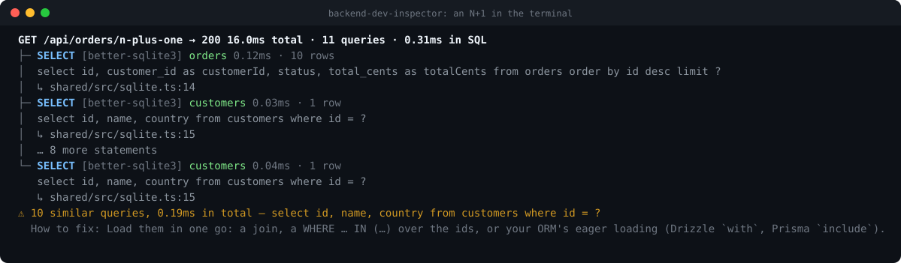
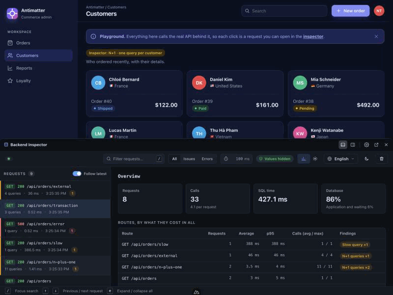
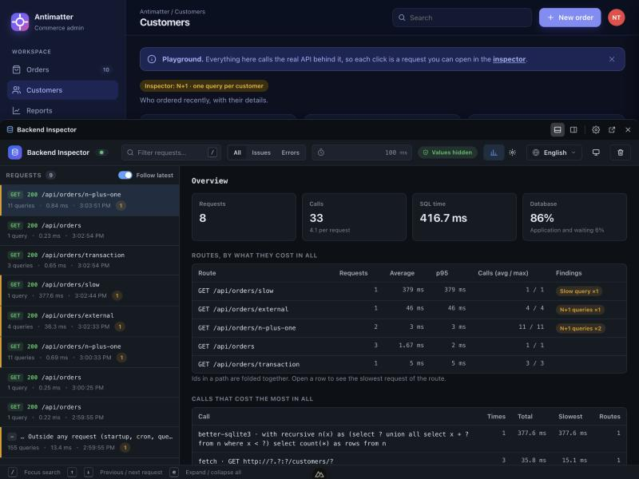
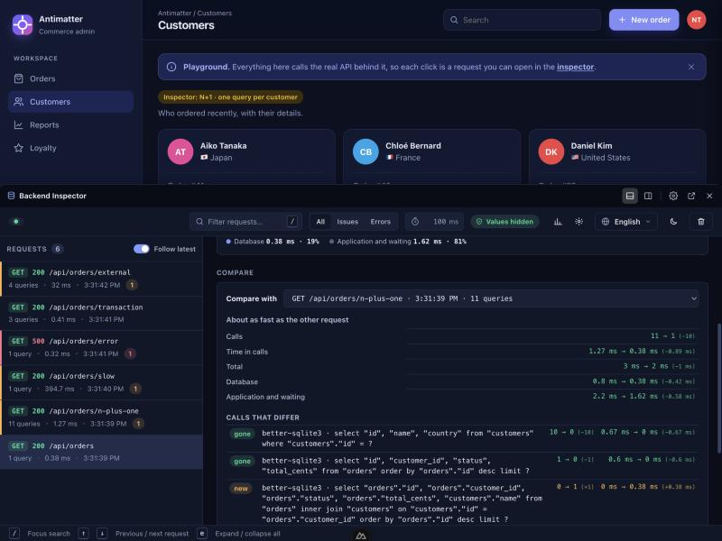

<h1 align="center">backend-dev-inspector</h1>

<p align="center">
  <b>See what your backend does for every request, in development only.</b><br>
  Every SQL query, MongoDB command, Redis call, cloud API call and outbound HTTP request, in order, with the line of code that made it, and a warning when something is wrong.
</p>

<p align="center">
  <a href="https://www.npmjs.com/package/backend-dev-inspector"></a>
  <a href="https://www.npmjs.com/package/sql-dev-inspector"></a>
  <a href="https://github.com/githubthinnd/backend-dev-inspector/actions/workflows/ci.yml"></a>
  
  <a href="LICENSE"></a>
</p>

<p align="center">
  
</p>
<p align="center"><sub>The inspector as a panel inside your own app (a debug bar), on the <a href="playground">playground</a>'s Nuxt 3 shop admin. Open it with the floating button or <kbd>Alt</kbd>+<kbd>Shift</kbd>+<kbd>S</kbd>.</sub></p>

## Contents

- [What it is](#what-it-is)
- [Which package](#which-package)
- [Quick start](#quick-start)
- [What you get](#what-you-get)
- [Supported technologies](#supported-technologies)
- [What it tells you](#what-it-tells-you)
- [Safe to leave in your project](#safe-to-leave-in-your-project)
- [Try it without a database](#try-it-without-a-database)
- [Repository layout](#repository-layout)
- [Develop](#develop)
- [Security, license](#security-license)

## What it is

A slow endpoint is rarely one slow query. It is the same query run forty times, a cache that misses on every call, or a payment API called inside a loop. Logs do not show that, and an APM is overkill on a laptop. These tools put it in front of you **while you build**:

- **One tree per request**, across SQL, MongoDB, Redis, cloud SDKs and outbound HTTP, with transactions and savepoints nested the way they ran.
- **Warnings that point at the cause**: N+1 loops, repeated calls, slow calls, errors, too many statements, and routes that go over a budget you set. Each says **how to fix it**.
- **The line of code that made each call**, even under a dev server's bundle (it reads source maps), as a link that opens your editor.
- **Three views**: a tree in the terminal, a page at `/__sql-inspector/`, and a **panel inside your app** (the debug bar above).
- **No change to your code paths**: it observes the libraries your app already uses (`pg`, `postgres.js`, `mysql2`, `libSQL`, `mongodb`, `ioredis`, `fetch`…). A few libraries need one line, listed below.
- **Dev only**: nothing runs when `NODE_ENV=production`. Nothing is written to disk or sent anywhere unless you ask for it.

<p align="center">
  
  
</p>
<p align="center">
  
  
  
</p>

<p align="center">
  
</p>
<p align="center"><sub>Real output of the <a href="playground/apps/express-sqlite">express-sqlite playground app</a>, which you can run without a database.</sub></p>

## Which package

This repository holds two npm packages.

| | [`backend-dev-inspector`](packages/backend-dev-inspector) | [`sql-dev-inspector`](packages/sql-dev-inspector) |
|---|---|---|
| **Covers** | **Databases:** PostgreSQL, MySQL / MariaDB, SQLite, libSQL / Turso, MongoDB, Redis, Neon, Cloudflare D1. **ORMs and builders:** Drizzle, Prisma, Kysely, Knex, Sequelize, TypeORM, Mongoose. **Also:** outbound HTTP, AWS SDK, Elasticsearch, BullMQ, db0 | MySQL / MariaDB through `mysql2` (and Drizzle, Knex, Sequelize, TypeORM on top of it) |
| **Frameworks** | Express, NestJS, Fastify, Koa, Hono, tRPC, Nuxt / Nitro, Next.js, SvelteKit, Astro, Remix / React Router, Vite, plain Node | Express, Nuxt / Nitro, plain Node |
| **Relation** | builds on `sql-dev-inspector` and exports everything it does | the base of the other package; works on its own |
| **Install** | `npm i -D backend-dev-inspector` | `npm i -D sql-dev-inspector` |

Not sure which one? Use **`backend-dev-inspector`**: switching from the other later is a change of import path.

## Quick start

```bash
npm install --save-dev backend-dev-inspector
```

```ts
// Express, Connect, NestJS
import { createInspector } from "backend-dev-inspector"

const inspector = createInspector()
app.use(inspector.middleware) // before any route that uses a database
```

Run your app with `NODE_ENV=development`, make a request, and open `http://localhost:3000/__sql-inspector/`. Setup for every other framework (Fastify, Koa, Hono, Nuxt, Next.js, SvelteKit, Astro, Remix, tRPC, NestJS, Vite, Bun, Deno, plain Node) is in the [package guide](packages/backend-dev-inspector#quick-start).

## What you get

<p align="center">
  
</p>

| | |
|---|---|
| **Where the time went** | Each request split into database, cache, outbound HTTP and your own code. Calls that ran at the same time are counted once. |
| **Compare two requests** | Before and after a fix: which calls are new, gone, repeated more or fewer times, or slower, and which warnings went away. |
| **Overview** | The recent requests added up by route, by call and by finding: what to optimise first. |
| **Copy, export, save** | A request as Markdown for a bug report, as JSON, or as OpenTelemetry (OTLP) traces; the whole history to a file you keep, and back. |
| **Budgets** | `calls`, `ms` and `callMs` limits per route, with a warning when a request goes over, and `toBeWithinBudget` for tests. |
| **The real SQL** | What an ORM sends to the database, under the call you wrote (Prisma). |
| **Across services** | W3C `traceparent` between your services, so one operation can be followed through each service's inspector. |
| **For people and agents** | A read-only **MCP server** for coding agents (Claude Code, Cursor…), **query budgets in tests**, an `npx backend-dev-inspector doctor` command, a Nuxt DevTools tab and a [VS Code extension](extensions/vscode). |
| **Under your control** | Hide values, follow only the routes you choose, serve the page from a path you pick, protect it with a token. |

<p align="center">
  
  
</p>

## Supported technologies

| Area | Supported |
|---|---|
| **Databases** | PostgreSQL (`pg`, `postgres.js`, Neon over HTTP), MySQL and MariaDB (`mysql2`, `mariadb`), SQLite (`better-sqlite3`, `node:sqlite`, Cloudflare D1), libSQL and Turso (`@libsql/client`), MongoDB (`mongodb`, Mongoose), db0 (Nitro `useDatabase()`, NuxtHub), Elasticsearch |
| **Caches and queues** | Redis (`ioredis` 5 and 6, `redis` 6), BullMQ |
| **Cloud and HTTP** | AWS SDK v3, `node:http`, `node:https`, global `fetch`, `undici` |
| **ORMs and builders** | Drizzle, Prisma 7, Kysely, Knex, Sequelize, TypeORM, Mongoose, through the drivers above |
| **Frameworks** | Express 5, Connect, NestJS, Fastify 5, Koa 3, Hono 4, tRPC, Nuxt 3 and 4, Nitro, Next.js (App Router, with server components and actions), SvelteKit, Astro, Remix / React Router, Vite, Bun, Deno, Workers, plain Node `http` |
| **Languages of the UI** | English, Vietnamese, Japanese |

The AWS SDK, Elasticsearch, BullMQ, Neon, D1, postgres.js 3, MariaDB and Prisma take **one line** (`instrumentAws(client)`…) because those libraries give no other way in; none of them loads the library, so none adds a dependency. Each entry says how it is observed and **how far it has been verified** (real client, protocol mock, documented contract, or only expected to work) in the [package guide](packages/backend-dev-inspector#supported-technologies). Not supported: Nuxt 2, and databases without a driver listed above.

## What it tells you

| Insight | Raised when |
|---|---|
| **N+1** | 3 or more calls of the same shape, with different values, in one request |
| **Duplicate** | the exact same call twice or more |
| **Slow** | a call takes at least the threshold (default 100 ms, adjustable live) |
| **Error** | the call was rejected |
| **Many queries** | 30 or more calls in one request |
| **Over budget** | a request goes over the `calls`, `ms` or `callMs` limit you set for its route |

Calls that are not SQL count the same way: three `GET customer:<id>` calls to Redis, three requests to the same endpoint of another service, or a loop of S3 `GetObject` calls are an N+1.

## Safe to leave in your project

- **Off in production.** With `NODE_ENV=production` nothing is patched and the middleware only calls `next()`.
- **Local only, or behind a token.** The inspector page refuses non-local `Host` headers (DNS rebinding) and cross-site POSTs. For a container or a tunnel, set `SQL_INSPECTOR_TOKEN`: everything then needs it, and a value that is too short locks the inspector instead of leaving it open.
- **Values stay out by default.** Bind parameters are shown as their type and size (`<string:12>`), Redis values and HTTP credentials are not recorded, credential-looking URL parameters are hidden, and a stricter mode masks whole statements. Statements you wrote yourself can still contain values, so do not share your screen on real data.
- **Nothing leaves the process.** Data lives in the memory of the dev process. The inspector makes no network call of its own and writes nothing to disk but what you ask for: saving a history, exporting OpenTelemetry traces and forwarding them are things you do.
- **Small supply chain.** `sql-dev-inspector` has no runtime dependencies; `backend-dev-inspector` has one, `sql-dev-inspector`. The libraries they watch are optional peers or not dependencies at all. Tests fail if the source uses `eval`, child processes, network calls of its own, writes to disk, or reads environment variables outside one allow-list.
- **Verifiable releases.** Published from GitHub Actions with npm provenance and trusted publishing. Check an install with `npm audit signatures`.

Details, and the reasoning behind scanner alerts: [SECURITY.md](SECURITY.md) and the "Dependencies and supply chain" section of each package guide.

## Try it without a database

The [playground](playground) has a small shop admin, **Antimatter**, for each stack: Nuxt 3 (Drizzle, Prisma), Express (SQL, Drizzle), Fastify, Koa and Hono, and a two-service pair that follows one trace. Every screen calls its own API and maps to one thing the inspector detects: a healthy request, an N+1, a slow query, a database error, a transaction, an N+1 over HTTP. They run on SQLite, so nothing else needs to be installed.

```bash
npm run playground:install
npm run dev:nuxt3-drizzle --prefix playground   # then open the app and press Alt+Shift+S
```

## Repository layout

```
packages/sql-dev-inspector/       core: request tree, analysis, UI, MySQL driver, Express / Nuxt / Nitro / web adapters
packages/backend-dev-inspector/   drivers (pg, SQLite, MongoDB, Redis, HTTP, AWS, …) and framework adapters, on top of the core
playground/                       runnable demo apps, one per framework and data layer (a separate npm project)
extensions/vscode/                a small VS Code extension that opens the page next to your code (not published)
skills/dev-inspector/             an agent skill for finding and fixing a slow request through the MCP server
docs/media/                       screenshots and recordings used by the READMEs
```

## Develop

```bash
npm install            # both packages (workspaces)
npm run build          # sql-dev-inspector first, then backend-dev-inspector
npm run typecheck
npm test               # Node 22+; run `npm rebuild better-sqlite3` if you installed with --ignore-scripts
```

Tests drive the real client libraries against in-memory protocol servers, so no database or open port is needed: 523 tests in `sql-dev-inspector`, 184 in `backend-dev-inspector`. The playground has its own tests (`npm run playground:test`). See [CONTRIBUTING.md](CONTRIBUTING.md).

Releases are tagged `<package>@<version>` (for example `sql-dev-inspector@1.3.0`); a tag starts the publish workflow. Publish `sql-dev-inspector` before `backend-dev-inspector`.

## Security, license

Report a vulnerability as described in [SECURITY.md](SECURITY.md). Licensed under the [MIT license](LICENSE).
