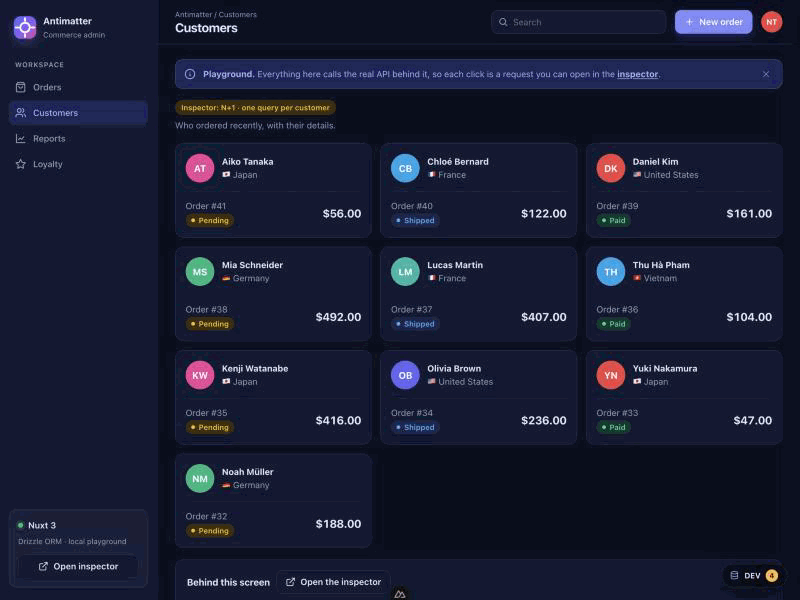
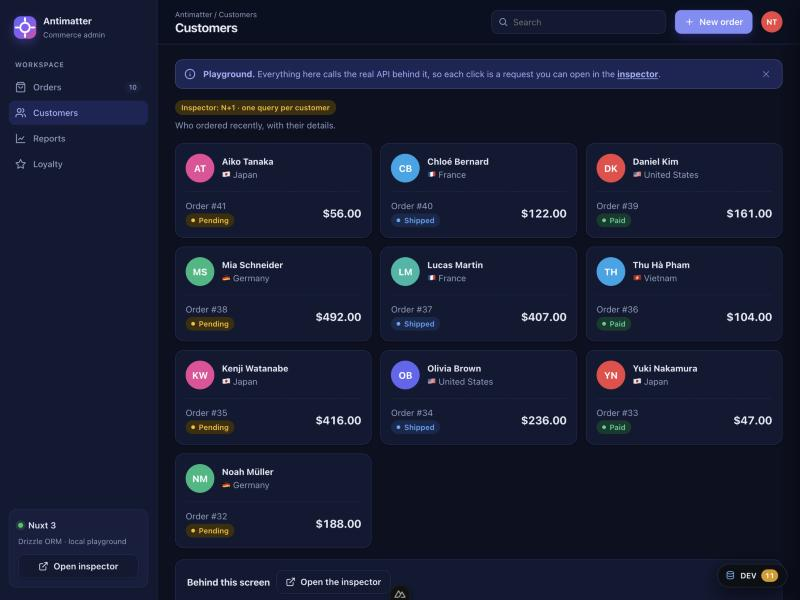
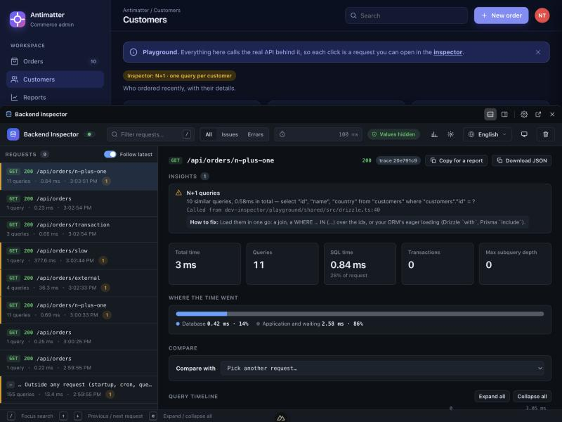
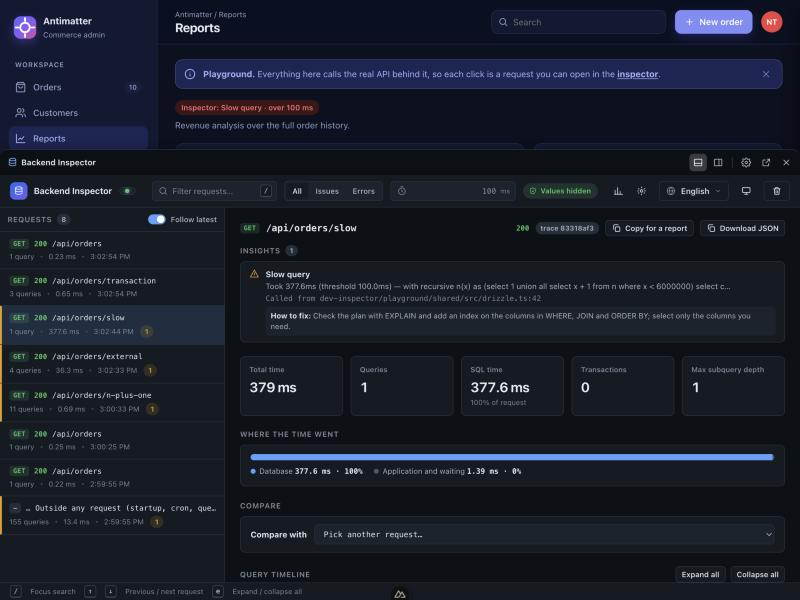
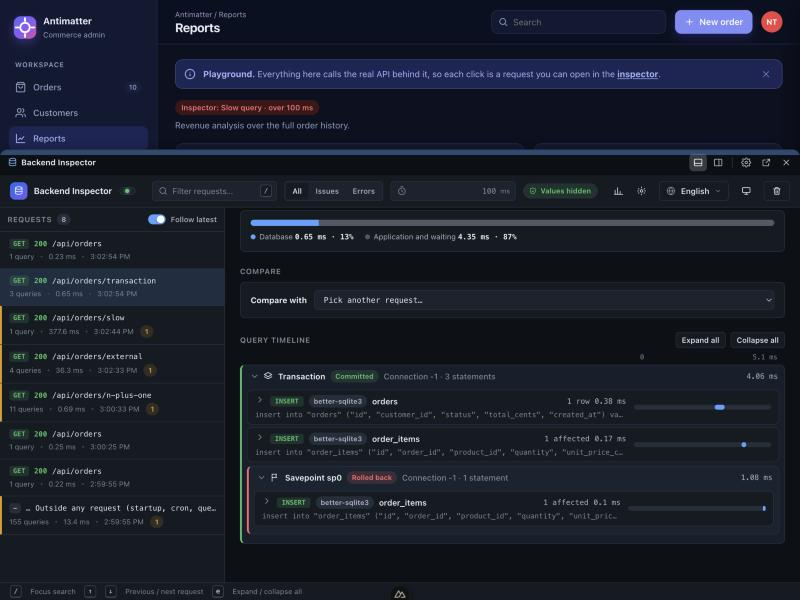
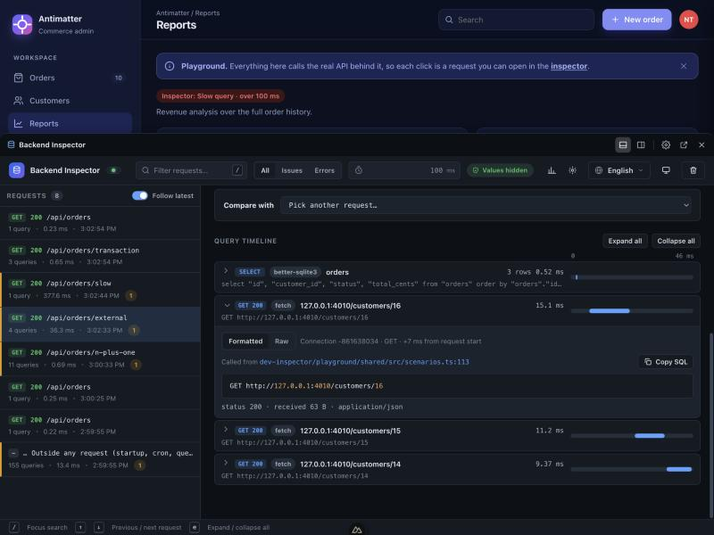

<h1 align="center">Playground</h1>

Runnable example apps for [`backend-dev-inspector`](../packages/backend-dev-inspector) (and the core, [`sql-dev-inspector`](../packages/sql-dev-inspector)): one app per framework and data layer. Each is a small shop admin, **Antimatter**, that calls its own API, so you use it like a real product and watch in the inspector what the server did for every click.

No database server is needed: the data is a seeded SQLite database (in memory, or a file for Prisma) and the "outside service" is a tiny fake HTTP server started by the apps.

<p align="center">
  
</p>
<p align="center"><sub>The inspector as a panel inside the app (a debug bar). Open it with the floating button or <kbd>Alt</kbd>+<kbd>Shift</kbd>+<kbd>S</kbd>.</sub></p>

<p align="center">
  
  
</p>
<p align="center">
  
  
  
</p>

## Contents

- [What you see](#what-you-see)
- [Apps](#apps)
- [Run one](#run-one)
- [The scenarios](#the-scenarios)
- [Tests](#tests)
- [Add an app](#add-an-app)
- [Troubleshooting](#troubleshooting)

## What you see

Open an app and you get a real-looking admin: orders, customers, reports, loyalty. Every screen is one of the scenarios below, and each has a **Behind this screen** card that says what you are doing, what the server runs, and what to look for in the inspector.

| Screen | What it does | What the inspector shows |
|---|---|---|
| **Orders** | The latest orders, with totals and a status; open one for its details | One joined query, no warning |
| Orders → **New order** | Places an order | A transaction that commits, with a savepoint that rolls back |
| Orders → open an order → **Add gift item** | An insert the database rejects | An error insight (foreign key) |
| **Customers** | Who ordered recently | An **N+1**: one query per customer |
| **Reports** | A heavy revenue aggregate | A **slow query** warning |
| **Loyalty** | Tiers read from another service | An **N+1 over HTTP** |

The data is fake (a seeded SQLite database, and a small fake customer service on port 4010), but the requests are real: the page uses `fetch` against the API of the app that serves it.

## Apps

| App | Framework | Data layer | Inspector hookup |
|---|---|---|---|
| [`nuxt3-drizzle`](apps/nuxt3-drizzle) | Nuxt 3 (Vue front end) | Drizzle ORM | module `backend-dev-inspector/nuxt` |
| [`nuxt3-prisma`](apps/nuxt3-prisma) | Nuxt 3 (Vue front end) | Prisma 7 (libSQL adapter) | module `backend-dev-inspector/nuxt` + `prismaExtension()` |
| [`express-sqlite`](apps/express-sqlite) | Express 5 | `better-sqlite3`, hand-written SQL | `createInspector().middleware` |
| [`express-drizzle`](apps/express-drizzle) | Express 5 | Drizzle ORM | `createInspector().middleware` |
| [`fastify-sqlite`](apps/fastify-sqlite) | Fastify 5 | `better-sqlite3` | `backend-dev-inspector/fastify` |
| [`koa-sqlite`](apps/koa-sqlite) | Koa 3 | `better-sqlite3` | `backend-dev-inspector/koa` |
| [`hono-sqlite`](apps/hono-sqlite) | Hono | `better-sqlite3` | `backend-dev-inspector/hono` |
| [`express-gateway`](apps/express-gateway) | Express 5, a gateway in front of the orders service of `express-sqlite` | outbound HTTP | W3C trace context between two services |

The Nuxt apps render the front end with Vue (a Nuxt layer in [`layers/antimatter-ui`](layers/antimatter-ui)); the others serve the same design as plain HTML and JavaScript from [`shared/web`](shared/web). Both use one stylesheet and one set of texts ([`shared/src/content.ts`](shared/src/content.ts)), so they look and read the same.

Not here: Nuxt 2 (the packages support Nuxt 3 and 4), Next.js, SvelteKit, Astro and the databases that need a server (PostgreSQL, MySQL, MongoDB, Redis). Their adapters are covered by the packages' own tests; an app for one of them follows the pattern below.

## Run one

**You need** Node.js 22 or newer. Run everything from the **repository root** (the folder with the root `package.json`, not from `playground/`).

```bash
npm install                     # the repository itself (once)
npm run playground:install      # builds both packages, then installs the playground
```

Then start the app you want:

| App | Command | Needs first |
|---|---|---|
| `nuxt3-drizzle` | `npm run dev:nuxt3-drizzle --prefix playground` | |
| `nuxt3-prisma` | `npm run dev:nuxt3-prisma --prefix playground` | `npm run generate --prefix playground` (generates the Prisma client; downloads Prisma's engine files) |
| `express-sqlite` | `npm run dev:express-sqlite --prefix playground` | |
| `express-drizzle` | `npm run dev:express-drizzle --prefix playground` | |
| `fastify-sqlite` | `npm run dev:fastify-sqlite --prefix playground` | |
| `koa-sqlite` | `npm run dev:koa-sqlite --prefix playground` | |
| `hono-sqlite` | `npm run dev:hono-sqlite --prefix playground` | |
| `express-gateway` | `npm run dev:express-sqlite --prefix playground` (orders, port 3000), then `npm run dev:express-gateway --prefix playground` (port 3020) | open `http://localhost:3020/api/gateway/fanout`, then search the orders inspector (`:3000/__sql-inspector/`) for the trace id shown in the gateway's |

Open the address it prints (port 3000, or the next free one), click through the screens, then open `/__sql-inspector/` or the **Open inspector** button. Nuxt apps also get the floating button. The terminal that runs the app prints the same tree for each request.

The apps use the packages **from this checkout** (linked, not downloaded from npm). After you change a package, run `npm run build` in the repository root; the apps pick up the new build on restart.

## The scenarios

Every app serves the same routes; the table says what the inspector should show.

| Route | What it does | What you should see |
|---|---|---|
| `/api/orders` | one joined query | one statement, no warning |
| `/api/orders/n-plus-one` | the orders, then each order's customer | an **N+1** warning (11 statements) |
| `/api/orders/slow` | a heavy aggregate (a few hundred ms) | a **slow query** warning |
| `/api/orders/error` | an item for an order that does not exist | an **error** insight (foreign key) |
| `/api/orders/transaction` | an order and its items in a transaction, with a savepoint that rolls back | a transaction node that commits, with a rolled-back savepoint (Prisma has no savepoints: the failing item is caught inside the transaction) |
| `/api/orders/external` | three calls to the fake customer service | an **N+1 over HTTP** |

The screens call these routes. The scenarios live in [`shared/src/scenarios.ts`](shared/src/scenarios.ts); each data layer implements the small `Repository` interface (`shared/src/sqlite.ts`, `shared/src/drizzle.ts`, `apps/nuxt3-prisma/server/utils/prisma-repository.ts`).

## Tests

```bash
npm test --prefix playground          # or: npm run playground:test
```

[`tests/scenarios.test.ts`](tests/scenarios.test.ts) boots each app **without opening a port** and checks that the inspector reports the expected insights for every scenario. [`tests/ui.test.ts`](tests/ui.test.ts) opens the front end in jsdom against the same apps and checks what a visitor sees (orders, a new order, the database error, N+1 customers, the report, the empty and error states, search). The outbound-HTTP scenario is not part of the first, because it needs the fake service on a port. The Prisma checks are skipped until the client is generated.

Two more files check the features that need more than one request or one service. [`tests/inspector-api.test.ts`](tests/inspector-api.test.ts) makes real requests to the Express app and then asks the inspector's own API about them, as a browser or a script would (the list, the overview, a comparison, Markdown / JSON / OpenTelemetry exports, a saved history loaded back, MCP). [`tests/multi-service.test.ts`](tests/multi-service.test.ts) runs the gateway and the orders service in one process, talking over real HTTP on in-memory sockets, and checks that the orders request belongs to the gateway's trace and answers its call.

CI runs this as its own job (`playground` in `.github/workflows/ci.yml`). The playground is a separate npm project with its own lockfile: its dependencies (Nuxt, Prisma…) never reach the packages, the root install or the publish workflow.

## Add an app

1. Copy the closest app in `apps/`, rename it, and wire the inspector the way the package README shows for that framework.
2. Serve `scenarios` from `@playground/shared` and answer with `runScenario(scenario, repo, context)`; add a `Repository` for a new data layer.
3. Add the app to `tests/stacks.ts` (a `boot()` that returns a `get(path)` function) and to the table above.

## Troubleshooting

- **The inspector page is empty.** The packages are linked from `../packages/*/dist`: run `npm run build` in the repository root. The inspector only runs outside production (the apps set `NODE_ENV=development` themselves).
- **`better-sqlite3` cannot be loaded.** It is a native module, built by the repository's own install: run `npm rebuild better-sqlite3` in the repository root. The playground deliberately has no copy of its own: the packages and the apps must share one, or the inspector would watch a different copy than the one the app uses.
- **`EADDRINUSE` on port 4010.** Another app already serves the fake customer service; that is fine, they share it. Port 3000 busy: set `PORT=3001`.
